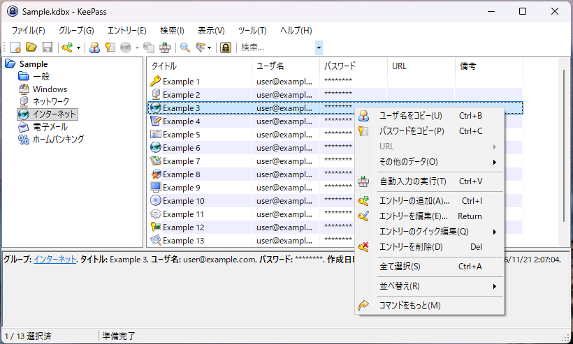

# KeePass Password Safe 日本語版

[KeePass](https://keepass.info/) は、無料で使えるオープンソースのパスワード管理ソフトです。サイトごとに異なるパスワードを生成し、ユーザー名や URL と一緒に、暗号化されたデータベース（`.kdbx` ファイル）に保存できます。

同じパスワードを使い回すと、ひとつのサイトから漏れただけで、ほかのアカウントにもログインされてしまうおそれがあります。KeePass にサイトごとのパスワードを預ければ、**覚えておくのは、データベースを開くためのマスターパスワードひとつだけ**です。

## ダウンロード

[**日本語版の最新リリースを開く**](https://github.com/kkato233/KeePass/releases/latest) →「Assets」から、ファイル名が `-jp.zip` で終わる ZIP を選んでください。「Source code」は開発者向けのソースコードです。

[KeePass 2.62 日本語版を直接ダウンロード（ZIP）](https://github.com/kkato233/KeePass/releases/download/v2_62/KeePass-2.62-jp.zip)

## オリジナル（英語）版との違い

このリポジトリでは、[公式の KeePass Password Safe](https://keepass.info/) をもとに、Windows 向けの日本語版を配布しています。

| この配布版の特徴 | 利用者にとっての意味 |
| --- | --- |
| 日本語リソースを同梱 | 言語パックを別途ダウンロードする必要はありません。初回起動から日本語のメニューで操作できます。 |
| AI によるセキュリティチェック | コードの問題を見つけるために AI を使ったチェックを実施しています。 (※すべての脆弱性が見つかることを保証するものではありません。) |
| リリースの実行ファイルにコード署名 | `KeePass.exe` を右クリックし、「プロパティ」→「デジタル署名」→「詳細」で、署名者と署名が有効かどうかを確認できます。署名は、署名後にファイルが書き換えられていないかを確かめるためのものです。 |

## はじめて使う

1. ダウンロードした ZIP をフォルダーごと展開し、`KeePass.exe` を起動します。
2. 「ファイル」から新しいデータベースを作成します。マスターパスワードには、ほかで使っていない、長くて自分が覚えられるフレーズを選んでください。忘れてもリセットはできません。
3. サイトごとに「エントリー」を追加し、サイト名、ユーザー名、パスワード、URL を登録して保存します。新しいパスワードを生成した場合は、サイト側でもそのパスワードを設定してください。

ログインするときは、図のように目的のエントリーを右クリックし、「パスワードをコピー」を選んでサイトの入力欄に貼り付けます。パスワードを画面に表示したり、手で入力したりする必要はありません。

## 複数の Windows 端末で使う

自宅と外出先の PC で同じパスワードを参照したいときは、OneDrive や Dropbox などの**自分だけがアクセスできる同期フォルダー**に、展開した KeePass のアプリ一式と `.kdbx` ファイルを一緒に保存しておくと便利です。各 PC でそのフォルダーを同期すれば、同じデータベースを開けます。

更新した PC でデータベースを保存して閉じ、**次の PC でクラウドの同期が完了してから**開くと、最新の内容を参照できます。同期は削除や上書きも反映するため、データベースのバックアップは同期フォルダーとは別の場所に保管してください。

### 両方の PC で更新してしまったら

クラウドに競合コピーができても、どちらかを上書きする必要はありません。たとえば、自宅で通販サイト、外出先でメールのパスワードを更新した場合、KeePass の「同期」を使えば両方の変更をまとめられます。

1. 更新したふたつの `.kdbx` ファイルを、それぞれ別名でバックアップします。
2. KeePass で一方を開き、「ファイル」→「同期」→「ファイルと同期...」から、もう一方を選びます。同じデータベースから分かれたふたつのコピーが、統合された同じ内容になります。
3. 更新したエントリーを確認し、以後はひとつのファイルを使います。両方で**同じエントリー**を編集した場合は、通常、更新日時が新しいほうが採用されるため、そのエントリーの履歴も確認してください。

詳しくは [KeePass 公式ヘルプ：データベースの同期（英語）](https://keepass.info/help/v2/sync.html) を参照してください。
